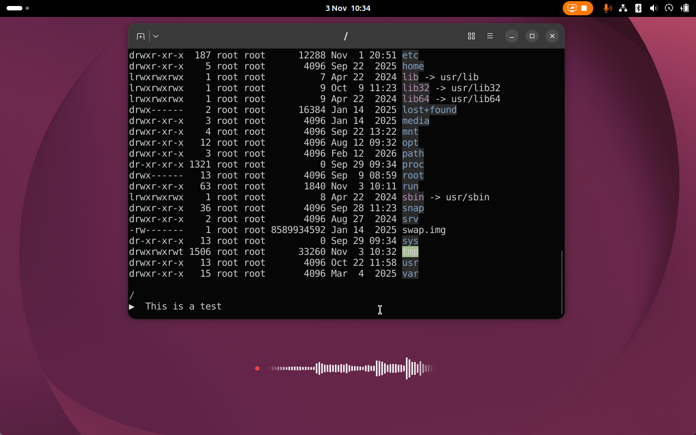

# Voxtype Wave OSD

A GNOME Shell extension that puts a small waveform on screen while
[voxtype][voxtype] is recording. Wispr Flow has an overlay like this, and once
you're used to it, dictating without one feels like talking into a phone that
might be on mute.



voxtype comes with its own visualizer (`voxtype-osd`). It needs the Wayland
layer-shell protocol, though, and GNOME doesn't implement that. On GNOME only
the shell itself gets to draw on top of other windows. So this is an extension.

## Requirements

- GNOME Shell 50
- voxtype 1.0, with the daemon running (`systemctl --user enable --now voxtype`)

You can leave voxtype's `[osd]` setting off. The daemon opens its audio-level
socket either way, and that socket is all this extension reads.

## Install

```bash
make install     # symlinks this checkout into ~/.local/share/gnome-shell/extensions
```

GNOME Shell looks for extensions once, at startup, and on Wayland you can't
restart it in place. Log out and back in, then:

```bash
make enable
```

## Usage

Press your voxtype hotkey. A red dot and a scrolling waveform fade in near the
bottom of the primary monitor. When you stop the recording they fade out, even
if voxtype is still typing the last words.

The bars are white over dark content and black over light content. The dot gets
a ring in the same colour.

It lives in the same layer as GNOME's volume popup, so it stays visible over
fullscreen windows. Your keyboard focus stays where it was, and clicks go
straight through to whatever is underneath.

## How it works

- **Audio levels** come from `$XDG_RUNTIME_DIR/voxtype/audio.sock`. The daemon
  writes a 16-byte frame (`u32 seq, f32 min, f32 max, f32 peak_dbfs`, native
  byte order) every 10 ms, and only while it's recording.
- **Recording state** is guessed from those frames. The first frame shows the
  overlay; 300 ms of silence on the socket hides it. Nothing polls
  `voxtype status` and no subprocesses get spawned.
- **Stopping** in streaming mode is spotted early. voxtype keeps the socket
  busy while it finishes typing, with a silence pump: frames of exact zeros
  whose sequence number starts over at 0. The overlay hides on the first of
  those. A muted mic is silent too, but its sequence keeps counting, so it
  doesn't trip this.
- **Reconnecting** happens every 2 seconds while the daemon is down or
  restarting.
- **Drawing** turns every two frames into one bar, so 20 ms per bar. Heights go
  through a power curve because quiet speech would otherwise barely register.
  Both ends of the wave fade out, which makes it look like it never ends.
- **Light or dark** gets decided once per recording, right before the overlay
  appears. It reads ten pixels where it's about to draw, with
  `Shell.Screenshot.pick_color`, and averages their brightness. If that lands
  in the grey middle, or the samples disagree wildly (half a white window, half
  a dark one), it goes with your system colour scheme. Same if sampling takes
  longer than 200 ms or fails; the overlay never waits on it for longer. The pixels are only
  turned into a brightness number; nothing is stored or sent anywhere.

## Development

```bash
make check    # lint and run tests
make test     # headless test suite, no GNOME Shell needed
make lint     # eslint (npm install first)
make logs     # follow gnome-shell output
make nested   # nested devkit shell (GNOME 49+: needs mutter-dev-bin on Ubuntu)
make pack     # distributable zip
```

`make nested` starts a nested GNOME Shell through the Mutter Development Kit
(`gnome-shell --devkit --wayland`) and enables the extension in it. It runs with
the in-memory GSettings backend, because the nested shell shares dconf with
your real session and would otherwise enable the extension there too. Record
something with voxtype and the overlay shows up in the nested window.

The target also stubs out `org.freedesktop.secrets` and turns portals off.
Without that, xdg-desktop-portal sits for about 25 seconds waiting for a
gnome-keyring that never comes.

`tests/smoke.js` runs under plain `gjs`. Most of it checks the pure logic in
`lib/`. The interesting part spins up a fake voxtype daemon on a temporary
socket and checks that frames split across reads come out whole, and that the
client reconnects and shuts down cleanly.

### Layout

| Path | Process | Notes |
| --- | --- | --- |
| `extension.js` | shell | Entry point; wires the socket to the overlay |
| `shell/waveOverlay.js` | shell | Floating `St.DrawingArea`, show/hide and drawing |
| `shell/backgroundMode.js` | shell | Samples the screen behind the overlay |
| `lib/levelSocket.js` | shared | Socket client with reconnect |
| `lib/frames.js` | shared | Frame decoder |
| `lib/wave.js` | shared | Bar heights and edge fade |
| `lib/contrast.js` | shared | Light/dark decision from brightness samples |
| `lib/stopDetector.js` | shared | Spots voxtype's post-stop silence pump |
| `tests/` | — | Headless gjs checks |

Nothing in `lib/` may import `St`, `Clutter`, `Gtk`, `Gdk` or `Adw`. That's
what lets the tests run without a shell.

### Agentic development

`best-practices.md` is GNOME's own guidance for extension code, the same
document EGO reviewers work from. The rules in `.cursor/rules/` spell out this
repo's conventions and how to verify a change. Run `make check` before calling
anything done.

## Caveats

- The light/dark choice is made once, when recording starts. Scroll a white page
  under a dark terminal mid-sentence and the bars keep the old colour until the
  next recording.
- It only appears on the primary monitor.
- There are no preferences. Size, position and colours are constants in
  `shell/waveOverlay.js`.
- The stop is only seen once voxtype handles it. voxtype doesn't react to the
  hotkey while it's busy typing a partial result, so the overlay can linger for
  a moment after you press it.
- Early hiding relies on voxtype's silence pump, which is an implementation
  detail, not a documented protocol. In batch (non-streaming) mode there is no
  pump; the overlay simply hides when the frames stop.

## License

Free software under the [GNU General Public License v2.0 or later](LICENSE)
(`GPL-2.0-or-later`).

[voxtype]: https://github.com/peteonrails/voxtype
